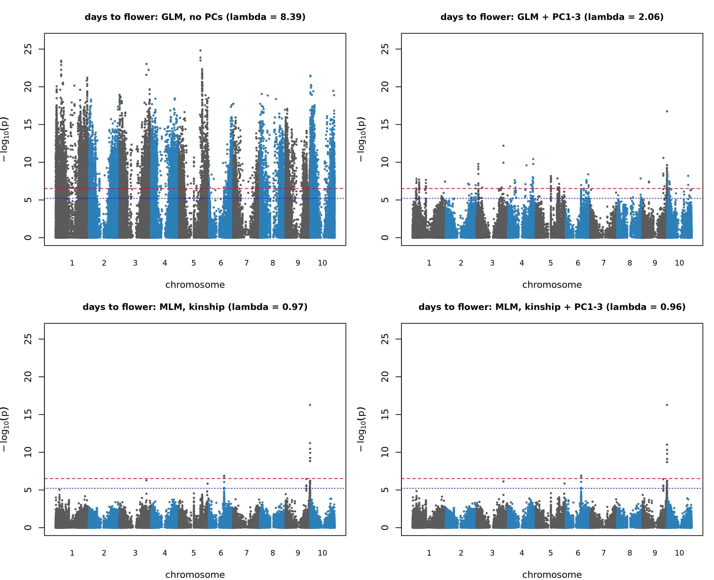
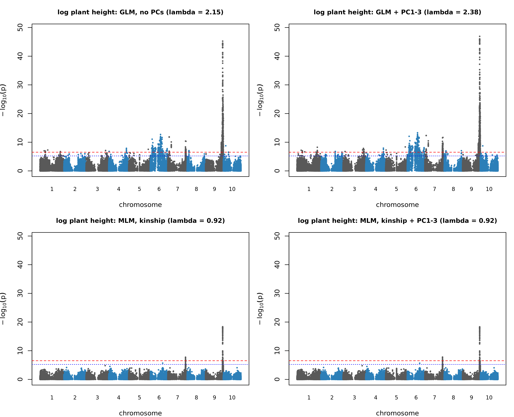
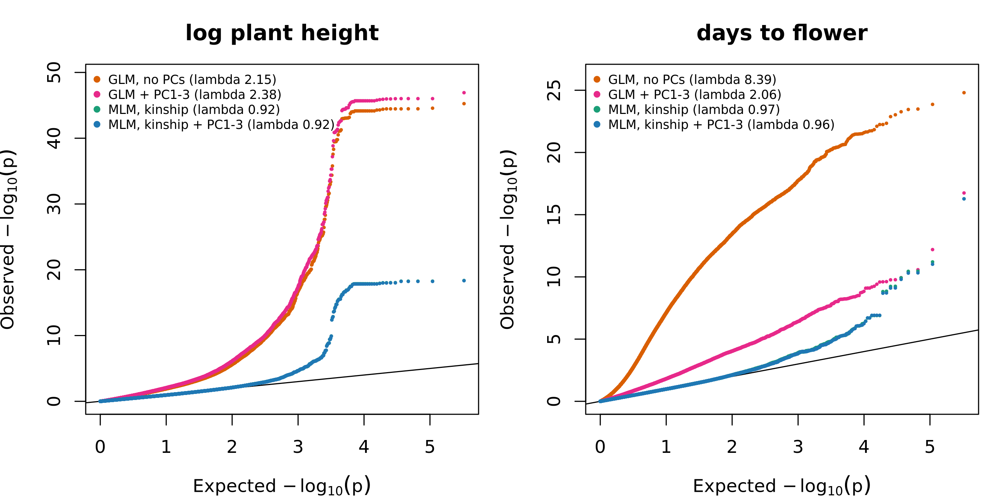

# Sorghum GWAS (Project 2): plant height and flowering time

Genome-wide association study of plant height and days to flower in the Sorghum Association Panel (SAP) and Sorghum Diversity Panel (SDP), using public data (Dryad doi:10.5061/dryad.3j9kd51w9). The project asks which genomic regions are associated with the two traits under high nitrogen, and how much correcting for population structure and relatedness changes the answer.

**Status:** complete. The whole workflow reruns from a fresh clone with one command (see [Reproducing the analysis](#reproducing-the-analysis)).

More detail: [DATA.md](DATA.md) (data description and QC decisions), [RESULTS.md](RESULTS.md) (full results tables) and [PLAN.md](PLAN.md) (project plan).

## Key findings
- **Structure correction matters a great deal.** A naive GLM gave genomic inflation (lambda) of 8.4 for days to flower and 2.2 for plant height, with 19,341 and 1,230 SNPs past Bonferroni. A mixed model with kinship brought lambda to 0.96 and 0.92 and left 15 and 77 SNPs. Kinship did the work; adding principal components changed almost nothing.
- **Four loci pass Bonferroni in the primary model:** two for plant height (chromosomes 9 and 7) and two for days to flower (chromosomes 9 and 6).
- **The height loci contain known dwarfing genes.** The chromosome 9 locus contains the gene that is probably the v5.1 model of Dw1, and the chromosome 7 locus contains Dw3 (an ABCB-type auxin transporter). The method recovers known biology, which is a useful positive control.
- **Neither flowering locus is at a known maturity gene.** Ma1 and Ma6 show no flowering signal in this panel.
- **One locus is tentative:** the chromosome 6 flowering locus has a rare lead allele (frequency 0.057, 46 lines) in a gene with extreme SNP density.

## Data
- **Source:** Dryad dataset doi:10.5061/dryad.3j9kd51w9 (public domain; Subash, Mangal, Shrestha, Xu, Schnable and Yang, University of Nebraska-Lincoln).
- **Genotypes:** SNPs called from leaf RNA-seq of 815 lines (SAP plus SDP) against the BTx623 v5 reference: 346,222 variants (277,724 SNPs and 68,498 indels). The authors had removed variants with minor allele frequency below 0.01 or more than 10% heterozygous calls. The VCF shows Beagle processing but no marker carries an imputation flag, so imputed genotypes cannot be identified.
- **Phenotypes:** the 2021 Lincoln, Nebraska field experiment, high-nitrogen treatment, two replicates. Plant height and days to flower were averaged per line. The dataset README gives plant height in centimetres, but the values (median 0.94) are consistent with metres, so metres are used here (inferred).
- **Lines analysed:** 812 (the non-accession "Border" and two lines lacking height data were removed).
- **Gene annotation:** BTx623 v5.1 (JGI Phytozome, Fort Lauderdale data-use terms), taken from the SorghumBase FTP (release 11) and checked by md5. It is downloaded by the workflow and not redistributed here.

## Methods
| Stage | What was done |
|---|---|
| Genotype QC | Biallelic SNPs only (277,724), minor allele frequency >= 0.05 (164,212 SNPs for GWAS), then LD thinning (r2 < 0.2, 50-SNP window; 23,900 SNPs) used only for PCA and kinship. Transition/transversion ratio 1.59; no missing genotypes; median per-line heterozygosity 0.9% |
| Phenotype QC | Plant height was right-skewed (skewness 2.01) and was log-transformed (0.65); days to flower (skewness 0.38) was left as it was. Two impossible height records (above 5 m) were set to missing. 16 tall lines (|z| > 3) were kept and flagged |
| Population structure | VanRaden kinship matrix and PCA on the 23,900 pruned SNPs. PC1 to PC3 explain 5.4%, 3.9% and 3.5%: weak, continuous structure |
| GWAS | rMVP (1.4.6): GLM without covariates, GLM with PC1 to PC3, MLM with kinship, MLM with kinship and PC1 to PC3 (the primary model) |
| Thresholds | Bonferroni over 164,212 SNPs, p = 3.04e-07 (-log10 6.52), called significant; 1/m, p = 6.09e-06 (-log10 5.22), called suggestive |
| Loci and genes | Significant SNPs merged with SNPs in LD (r2 >= 0.5) with each lead SNP; genes in each region listed from the v5.1 annotation; known dwarfing and maturity genes checked |
| Robustness | Models refit without the flagged outlier lines and with a rank-based inverse-normal transform |

## Results

### Why structure correction matters
| Trait | Model | Lambda | SNPs past Bonferroni |
|---|---|---|---|
| log plant height | GLM, no covariates | 2.16 | 1,230 |
| log plant height | GLM + PC1 to PC3 | 2.38 | 1,447 |
| log plant height | MLM, kinship | 0.92 | 77 |
| log plant height | MLM, kinship + PC1 to PC3 | 0.92 | 77 |
| days to flower | GLM, no covariates | 8.39 | 19,341 |
| days to flower | GLM + PC1 to PC3 | 2.06 | 153 |
| days to flower | MLM, kinship | 0.97 | 15 |
| days to flower | MLM, kinship + PC1 to PC3 | 0.96 | 15 |

Principal components alone do not fix the inflation; kinship does. For days to flower, the naive GLM's top hit (chromosome 5) disappears once structure is modelled. Hits absent from the mixed model are not proven false positives, because mixed models also lose power, but with lambda 8.4 most are very likely false.



*Days to flower under four models (red dashed line: Bonferroni; blue dotted line: 1/m). The naive GLM is above the Bonferroni line on every chromosome; the mixed models leave a chromosome 9 peak and a weaker chromosome 6 signal.*



*Log plant height under the same four models. One strong chromosome 9 locus appears in every model.*



*QQ plots. Naive GLM curves leave the diagonal immediately; mixed-model curves follow it until the tail.*

### Loci in the primary model (MLM, kinship + PC1 to PC3)
Positions are on BTx623 v5 (SNPs past Bonferroni, merged when within 1 Mb).

| Trait | Chr | Region (Mb) | SNPs | Lead SNP | Lead p | Effect per ALT allele |
|---|---|---|---|---|---|---|
| log plant height | 9 | 60.41 to 61.63 | 70 | 9:60868876 | 4.6e-19 | 0.170 (about +18.5%) |
| log plant height | 7 | 62.97 to 63.40 | 7 | 7:62972026 | 1.7e-08 | 0.090 (about +9.4%) |
| days to flower | 9 | 62.46 to 63.02 | 9 | 9:62620720 | 5.4e-17 | +2.27 days |
| days to flower | 6 | 39.50 to 39.53 | 6 | 6:39501656 | 1.2e-07 | +2.65 days |

Both chromosome 9 loci survive every robustness check (dropping the flagged outlier lines, and a rank-based inverse-normal transform). The tall lines contribute to the height signal (the lead p-value is about 100-fold weaker without them) but it stays far beyond the threshold. The two chromosome 9 lead SNPs are about 1.75 Mb apart with r2 = 0.21, so they are probably separate loci. Loci just past a threshold (chromosome 7 height, chromosome 6 flowering) probably have overestimated effects.

### Candidate genes (BTx623 v5.1)
| Locus | Gene | Evidence level | Notes |
|---|---|---|---|
| chr9 height | Sobic.009G229801 | known gene (Dw1), identity inferred | Dw1 is Sobic.009G229800 in the older annotation; that ID is absent from v5.1 and 229801 is the only gene with the prefix; position, strand and the v3.1 to v5.1 coordinate shift fit. The lead SNP is in the next gene, 24 kb away |
| chr9 height | Sobic.009G230500 | positional candidate | 232 bp from the lead SNP; F-box/tubby annotation (homology-based, from the sorghum QTL Atlas); about 20 kb from Dw1, so LD cannot separate them |
| chr7 height | Sobic.007G163800 | known gene (Dw3) | ABCB-type auxin transporter (Multani et al. 2003); inside the region, 208 kb from the lead SNP; its own SNPs are only suggestive |
| chr7 height | Sobic.007G161700 | positional candidate | contains the lead SNP; reported 0.20 Mb from Dw3 in an Ethiopian landrace GWAS (2019); function unknown |
| chr6 flowering | Sobic.006G051700 | positional; probable RPP13-like resistance gene | contains the lead SNP; named among three RPP13-like genes in the qtlMs-6.3 aphid-resistance interval (Zhang et al. 2021); 110 SNPs in 5.8 kb; link to flowering unclear, so tentative |
| chr9 flowering | Sobic.009G254200 | positional only | contains the lead SNP; uncharacterised; about 90 genes in the region |

Dw2 (Sobic.006G067700) reaches only a suggestive level for height (-log10 p 5.64). Full tables: [RESULTS.md](RESULTS.md) and `results/candidate_genes_final.tsv`.

## Limitations
- One environment (2021, high nitrogen, two replicates) and line means, so no genotype-by-environment analysis and no replication in an independent panel.
- Markers come from leaf RNA-seq: uneven genome coverage (mostly expressed regions; 88.5% of the SNPs lie inside annotated genes), possible mapping artefacts in highly variable gene families, and no way to filter by imputation quality.
- Minor allele frequency >= 0.05 removed 41% of the SNPs; rare variants are not tested.
- The kinship matrix includes the tested SNP's own region, which can make mixed models slightly conservative (lambda 0.92 for height).
- LD cannot separate the causal gene from its neighbours; candidate genes need fine-mapping or functional evidence. Functional annotations are homology-based or from the literature, not experimental evidence for these lines.
- The chromosome 6 flowering locus is tentative: rare allele, concentrated in a subgroup of the SAP, and a large effect from few SNPs.
- A published flowering-time study of the same panel uses overlapping data, so agreement with it would not be independent confirmation.
- No experimental validation.

## Reproducing the analysis
```bash
git clone https://github.com/philaAntony/sorghum-gwas.git
cd sorghum-gwas
conda env create -f environment.yml
conda activate sorghum-gwas
bash scripts/install_rmvp.sh        # rMVP is a CRAN package and is compiled here
# Download two files from the Dryad dataset into data/raw/ (Dryad blocks command-line downloads):
#   B.SDP_SAP_815_maf001_het10_imputed.recode.vcf.gz
#   2.SDP_SAP_f2021_field_phenotype.zip
bash scripts/run_all.sh
```
`run_all.sh` stops at the first error, downloads and checks the annotation, and runs every script in the table below. The run takes a few minutes on a laptop.

**Reproducibility check.** The environment was built from `environment.yml` and rMVP (1.4.6) compiled from CRAN in a clean environment. The workflow was then rerun from fresh clones of this repository with the two Dryad files supplied by hand: all eight per-SNP GWAS tables were byte-for-byte identical to the original run, and the PCA scores, gene lists, candidate-gene tables and summary files regenerated without any difference. Principal components are identical because the eigen-decomposition is deterministic here. This was tested on one machine (WSL2 on Windows); exact package versions are in `environment.lock.yml` and `results/software_versions.txt`.

## Repository contents
| Script | Step |
|---|---|
| `00_check_inputs.sh` | check the two Dryad files are in `data/raw/` |
| `00_download_annotation.sh` | download and checksum the BTx623 v5.1 annotation |
| `01_make_phenotype_table.py`, `01b_keep_samples.sh` | per-line phenotype means; list of lines kept |
| `02_genotype_qc.sh` | genotype filtering and SNP counts |
| `03_phenotype_qc.R`, `04_make_gwas_phenotypes.R` | phenotype distributions, transformation, GWAS phenotype files |
| `05_line_groups.py`, `05b_export_pruned.sh` | line groups; export of the pruned SNPs |
| `06_population_structure.R`, `07_pc_drivers.R` | kinship, PCA, structure versus traits, what drives each PC |
| `08_prepare_mvp.R`, `09_run_gwas.R` | convert genotypes for rMVP; run four models per trait |
| `10_plots.R` | Manhattan and QQ plots, loci, overlap between models |
| `11_sensitivity.R` | robustness checks (outlier lines, inverse-normal transform) |
| `12_ld_regions.sh`, `12b_lead_snp_checks.sh`, `13_chr6_check.R` | LD-based regions; lead SNP checks; carrier check for the chromosome 6 locus |
| `14_build_check.py`, `15_candidate_genes.py`, `16_known_genes.py` | annotation build check; genes in each region; known dwarfing and maturity genes |
| `17_software_versions.sh` | record software versions |

`00_check_sample_ids.py` and `00b_match_ids.py` are exploratory scripts used to harmonise sample names and are not part of the workflow. Raw data, intermediate files and the per-SNP GWAS tables are not tracked; summary tables are in `results/` and figures in `figures/`.

## Credits
Data: Subash et al., Dryad doi:10.5061/dryad.3j9kd51w9. Gene annotation: BTx623 v5.1 from JGI Phytozome, obtained through SorghumBase (Fort Lauderdale data-use terms apply). Software: PLINK 2, bcftools, R and rMVP.
