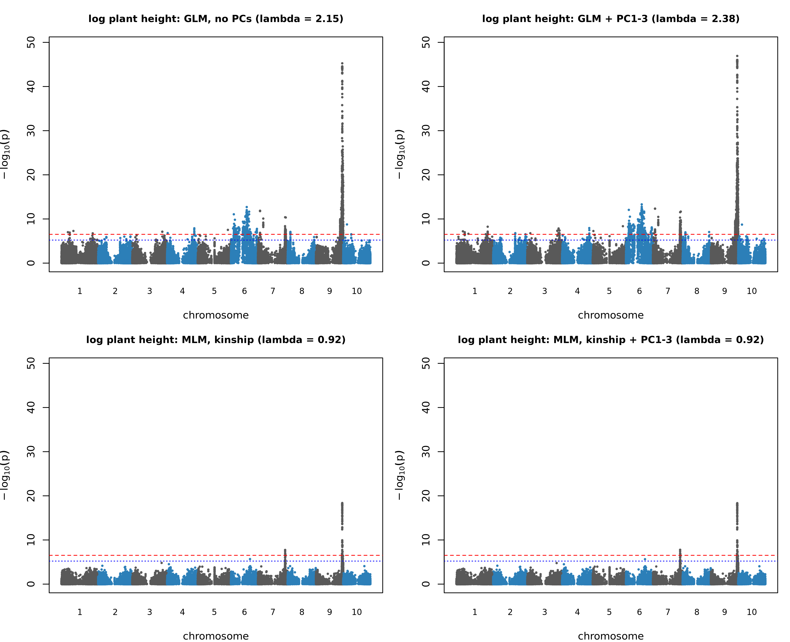
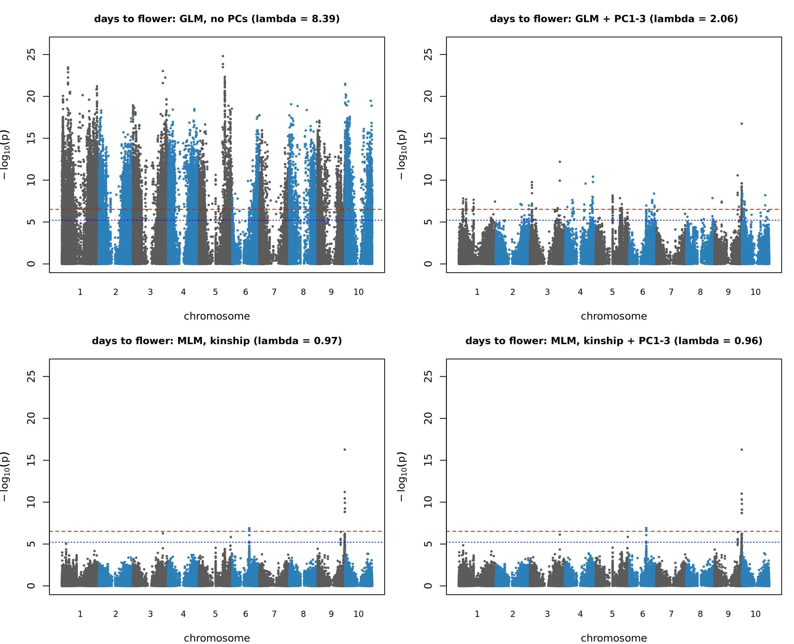
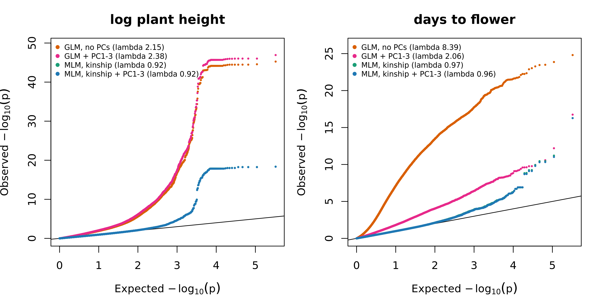

# Results (work in progress)

## GWAS models compared (Week 13)
rMVP; 164,212 SNPs, 812 lines. Bonferroni p = 3.04e-07 (-log10 6.52); 1/m p = 6.09e-06 (-log10 5.22). Full tables are in `results/gwas/` (not tracked); summaries in `results/gwas_lambda.tsv` and `results/gwas_top_hits.tsv`.

| Trait | Model | lambda | SNPs past Bonferroni | SNPs past 1/m | Top SNP |
|---|---|---|---|---|---|
| log plant height | GLM, no PCs | 2.155 | 1230 | 1888 | 9:60843527 |
| log plant height | GLM + PC1-3 | 2.38 | 1447 | 2257 | 9:60843527 |
| log plant height | MLM, kinship | 0.921 | 77 | 128 | 9:60868876 |
| log plant height | MLM, kinship + PC1-3 | 0.919 | 77 | 128 | 9:60868876 |
| days to flower | GLM, no PCs | 8.388 | 19341 | 27498 | 5:55801375 |
| days to flower | GLM + PC1-3 | 2.064 | 153 | 485 | 9:62620720 |
| days to flower | MLM, kinship | 0.966 | 15 | 38 | 9:62620720 |
| days to flower | MLM, kinship + PC1-3 | 0.962 | 15 | 39 | 9:62620720 |

- Mixed models bring lambda close to 1; the naive GLM is strongly inflated, most for days to flower (8.4).
- Adding PC1-3 alone does not fix the inflation; kinship does. With kinship in the model, PCs change almost nothing.
- Plant height: one strong locus on chromosome 9 (about 60.84 to 60.87 Mb) in every model, effect about 0.17 on the log scale.
- Days to flower: the naive GLM's top hit (chr5) is not supported once structure is modelled; the mixed models find chr9:62.62 Mb, about 1.75 Mb from the height peak.
- Positions are on the BTx623 v5 build; no gene annotation yet.
- Caveats: inflation in the GLM is not only structure (a strong locus in LD also raises lambda); lambda slightly below 1 under the mixed models may reflect the kinship matrix including the tested SNP's region.

## Visualisation and diagnostics (Week 14)
Scripts: `10_plots.R`, `11_sensitivity.R`. Tables: `results/gwas_loci.tsv`, `results/gwas_model_overlap.tsv`, `results/sensitivity_summary.tsv`, `results/ld_chr9_leads.tsv`.

**Primary model:** MLM with VanRaden kinship and PC1 to 3 (the standard Q + K model). Kinship alone gives almost the same result (identical numbers of significant SNPs), so the PCs add nothing in this panel.

**Thresholds:** Bonferroni over 164,212 SNPs, p = 3.04e-07 (-log10 6.52), is called significant; 1/m, p = 6.09e-06 (-log10 5.22), is called suggestive (one false positive expected per scan). Using the 23,900 LD-pruned SNPs as a rough count of independent tests would give -log10 5.68. Bonferroni over all SNPs is conservative because SNPs in LD are not independent tests.

*Manhattan plots for log plant height under four models. Red dashed line: Bonferroni; blue dotted line: 1/m. One strong chromosome 9 locus appears in every model; the naive GLM adds a broad chromosome 6 signal that falls below the Bonferroni line in the mixed models.*

*Manhattan plots for days to flower. The naive GLM (lambda 8.4) is above the Bonferroni line on every chromosome; the mixed models leave a chromosome 9 peak and a weaker chromosome 6 signal.*

*QQ plots for the four models per trait. Naive GLM curves leave the diagonal at once; mixed-model curves follow it until the tail. The plateau in the plant height curves is a block of SNPs in strong LD with similar p-values.*

### Loci in the primary model (MLM, kinship + PC1 to 3)
SNPs past Bonferroni merged when within 1 Mb.

| Trait | Chr | Region (Mb) | SNPs | Lead SNP | Lead p | Effect per ALT allele |
|---|---|---|---|---|---|---|
| log plant height | 9 | 60.41 to 61.63 | 70 | 9:60868876 | 4.6e-19 | 0.170 (about +18.5%) |
| log plant height | 7 | 62.97 to 63.40 | 7 | 7:62972026 | 1.7e-08 | 0.090 (about +9.4%) |
| days to flower | 9 | 62.46 to 63.02 | 9 | 9:62620720 | 5.4e-17 | +2.27 days |
| days to flower | 6 | 39.50 to 39.53 | 6 | 6:39501656 | 1.2e-07 | +2.65 days |

The chromosome 7 and 6 loci pass the threshold only narrowly, and effect sizes of hits near a threshold are likely overestimated.

### Why structure correction matters in this panel
- Days to flower: naive GLM lambda 8.4 and 19,341 SNPs past Bonferroni, against 15 in the mixed model; only 9 of the mixed model's 15 SNPs are among the naive hits.
- Plant height: lambda 2.2 and 1,230 naive hits against 77; 1,153 naive hits are absent from the mixed model.
- PCs alone do not fix the inflation (GLM + PC1 to 3: lambda 2.06 and 2.38); kinship does. With kinship in the model, PCs change nothing.
- Hits absent from the mixed model are not proven false positives (mixed models also lose power), but with lambda 8.4 most are very likely false.

### Sensitivity analyses
| Trait | Variant | Lines | Lambda | SNPs past Bonferroni | Top SNP | p at main lead SNP |
|---|---|---|---|---|---|---|
| height | main model | 812 | 0.919 | 77 | 9:60868876 | 4.6e-19 |
| height | 16 flagged tall lines dropped | 796 | 0.928 | 81 | 9:60868346 | 4.6e-17 |
| height | rank-based inverse normal | 812 | 0.931 | 70 | 9:60868876 | 1.4e-17 |
| flowering | main model | 812 | 0.962 | 15 | 9:62620720 | 5.4e-17 |
| flowering | 3 flagged lines dropped | 809 | 0.965 | 15 | 9:62620720 | 5.1e-18 |
| flowering | rank-based inverse normal | 812 | 0.965 | 18 | 9:62620720 | 1.6e-17 |

Both chromosome 9 loci survive every variant. The flagged tall lines contribute to the height signal (about 100-fold weaker at the lead SNP without them) but it remains far beyond the threshold. The summary does not show whether the two weaker loci survive.

### Linkage disequilibrium between the chromosome 9 lead SNPs
The height lead (9:60868876) and flowering lead (9:62620720) are about 1.75 Mb apart with r2 = 0.21, so they are probably separate loci that are partly but not strongly linked. A conditional analysis would test this.

### Limitations
- Positions are on BTx623 v5; no gene annotation has been applied yet.
- Markers are RNA-seq-derived and unevenly spread, so causal variants may not be typed.
- The kinship matrix includes the tested SNP's own region, which can make mixed models slightly conservative (lambda 0.92 for height); a leave-one-chromosome-out kinship would address this.
- A single environment (2021, high nitrogen) with two replicates per line; no replication in an independent panel.

### Lead SNP allele frequencies
ALT allele frequency of the lead SNPs: chr9:60868876 (height) 0.268; chr7:62972026 (height) 0.307; chr9:62620720 (flowering) 0.315; chr6:39501656 (flowering) 0.057. The chromosome 6 flowering locus has a rare lead allele (about 45 lines) and a large estimated effect, which fits an overestimated, fragile signal; it should be treated as tentative.

### Locus signal by model
Best -log10(p) in each locus window (Bonferroni line 6.52).

| Model | Height, chr9 | Height, chr7 | Flowering, chr9 | Flowering, chr6 |
|---|---|---|---|---|
| GLM, no PCs | 45.25 | 10.39 | 11.89 | 6.22 |
| GLM + PC1-3 | 46.92 | 11.53 | 16.74 | 6.37 |
| MLM, kinship | 18.37 | 7.74 | 16.28 | 6.89 |
| MLM, kinship + PC1-3 | 18.34 | 7.78 | 16.27 | 6.91 |

- The chromosome 9 loci for both traits and the chromosome 7 height locus are significant in every model.
- The chromosome 6 flowering locus passes Bonferroni only in the mixed models, narrowly, with a rare lead allele (0.057) and a large effect; it is reported as tentative.
- For flowering time on chromosome 9, adding PC1-3 to the GLM strengthens the signal (11.89 to 16.74), consistent with unmodelled structure adding noise and reducing power (not tested directly).
- Kinship alone and kinship + PC1-3 differ by 0.04 or less everywhere.

### chr6 flowering locus: carrier check (Week 15)
Script: `13_chr6_check.R`. Lead SNP 6:39501656 (ALT allele C, frequency 0.057): 46 lines are homozygous for the ALT allele, none heterozygous.
- Carriers by panel: 37 SAP lines and 9 non-SAP lines (SAP is 41% of the panel); none of the 96 SC-named lines carries the allele.
- Mean pairwise relatedness among the carriers is 0.025, against 0.006 for random sets of 46 SAP lines (95% range -0.001 to 0.018): a loosely related subset, not a tight family.
- Days to flower, within the SAP: carriers 72.74 days (n = 37) against 67.56 (n = 299), a gap of about 5.2 days (t-test p = 9.4e-06; the test ignores relatedness, so it is optimistic).
- Outside the SAP the 9 carriers average 67.17 days against 66.45 for the 467 non-carriers (about 0.7 days). With 9 lines this is weak evidence that the effect depends on background and could be noise.
- The locus is kept as tentative: rare allele, concentrated in a subgroup of the SAP, and not visible in the few non-SAP carriers.

### Known sorghum height and maturity genes (Week 15)
Script `16_known_genes.py`, output `results/known_genes_check.txt`. Annotation: BTx623 v5.1 (JGI), taken from the SorghumBase FTP (release-11); md5 in `data/annotation/annotation.md5`. Build check (`14_build_check.py`): 88.5% of the SNPs fall inside annotated genes against 16.7% of the genome being genic, and every chromosome's last SNP lies within the chromosome. Gene identities and v3.1 positions are from the literature (Dw1: Hilley et al. 2016 and Yamaguchi et al. 2016; Dw2: Hilley et al. 2017; Dw3: Multani et al. 2003; Ma1/PRR37: Murphy et al. 2011; summary of all loci: Grant et al. 2023).

Signal is -log10 p in the primary model (Bonferroni 6.52; 1/m 5.22).

| Gene | Trait | v5.1 position | Best in gene | Best within 500 kb | Relation to loci |
|---|---|---|---|---|---|
| Dw1 (Sobic.009G229800 in v3.1; v5.1 model probably Sobic.009G229801) | height | chr9:60.84 Mb | 17.8 | locus peak 18.3 | inside the chr9 height locus, 24 kb from the lead SNP |
| Dw3 (Sobic.007G163800) | height | chr7:63.18 Mb | 5.00 | 7.78 | inside the chr7 height locus, 208 kb from the lead SNP |
| Dw2 (Sobic.006G067700) | height | chr6:44.16 Mb | 5.64 | 5.64 | suggestive only |
| Ma1 (Sobic.006G057866) | flowering | chr6:41.66 Mb | 0.84 | 3.09 | no signal |
| Ma6 (Sobic.006G004400) | flowering | chr6:0.77 Mb | 1.86 | 3.63 | no signal |

- Ma1 and Dw2 shifted by the same amount between v3.1 and v5.1 (+1.36 Mb), which supports the gene identities; Dw1 shifted by +3.80 Mb. The identity of Sobic.009G229801 as the v5.1 Dw1 gene is inferred from position, strand and ID, not confirmed.
- The chr6 flowering locus (39.5 Mb) is about 2.1 Mb from Ma1 and is not Ma1; the chr9 flowering locus is not at a known maturity gene.
- Dw3 shows the weakest gene-level signal of the three height genes (its SNPs reach only -log10 5.0), although the locus passes the threshold 200 kb away; Dw3 has at least seven known mutant alleles, so marker SNPs may not track it well.

## Candidate genes (Week 15)
Annotation: BTx623 v5.1 (JGI) from the SorghumBase FTP; gene lists from `scripts/15_candidate_genes.py` (`results/candidate_genes.tsv`); final table in `results/candidate_genes_final.tsv`. Regions are the significant SNPs merged with SNPs in LD (r2 >= 0.5) with each lead SNP. Orthologs were read from the SorghumBase genome browser; the sorghum QTL Atlas gave the annotation for Sobic.009G230500. SNPs used for GWAS come from leaf RNA-seq, so genes not expressed in leaves have no markers.

| Locus | Gene (v5.1) | Evidence level | -log10 p in gene | Basis and caveats |
|---|---|---|---|---|
| chr9 height | Sobic.009G229801 | known gene (Dw1), identity inferred | 17.83 | Dw1 is Sobic.009G229800 in v3.1 (Hilley et al. 2016); that ID is absent from v5.1 and 229801 is the only gene with the prefix; the v3.1 to v5.1 shift (+3.80 Mb) matches the neighbouring gene; lead SNP is in the next gene, 24 kb away |
| chr9 height | Sobic.009G230500 | positional candidate | 18.23 | 232 bp from the lead SNP; 60 SNPs inside; F-box/tubby annotation from the QTL Atlas (OsFBT10), a homology-based annotation; about 20 kb from Dw1 in both builds, so LD cannot separate them |
| chr7 height | Sobic.007G163800 | known gene (Dw3) | 5.00 | ABCB-type auxin efflux transporter (Multani et al. 2003); inside the chr7 region, 208 kb from the lead SNP; its own SNPs are only suggestive |
| chr7 height | Sobic.007G161700 | positional candidate | 7.78 | contains the lead SNP; reported 0.20 Mb from Dw3 in an Ethiopian sorghum landrace GWAS (2019); function unknown |
| chr6 flowering | Sobic.006G051700 | positional; probable RPP13-like disease-resistance gene | 6.91 | contains the lead SNP; named among three RPP13-like genes in the qtlMs-6.3 interval (Zhang et al. 2021, Plant Breeding 140:618-629); no rice ortholog; 110 SNPs in 5.8 kb, typical of a highly variable gene family, possibly with mapping artefacts; link to flowering unclear, so tentative |
| chr9 flowering | Sobic.009G254200 | positional only | 16.27 | contains the lead SNP; uncharacterised; about 90 genes in the region |

- The two height loci contain genes with published roles (Dw1 and Dw3); the chr7 lead SNP lies in a different gene 208 kb away. The classic maturity genes (Ma1, Ma6) and Dw2 show no flowering signal in this panel.
- Neither flowering locus contains a known maturity gene.
- Agreement with a flowering-time paper on the same panel (Mangal et al.) would not be independent replication, because the datasets overlap.
- LD (r2 >= 0.5) does not allow the causal gene to be separated from its neighbours; candidates need functional or fine-mapping evidence.
